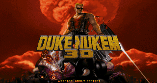
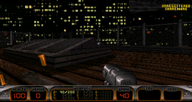

# czduke — Duke Nukem 3D on the M5Stack CardputerZero

Duke Nukem 3D for the [CardputerZero](https://github.com/CardputerZero) (Raspberry Pi CM0, 320×170 screen, 46-key keyboard). It installs as a normal `.deb` and shows up in the stock launcher as **DUKE3D**. It is the sibling of [czdoom](https://github.com/droomurray/czdoom) and is built the same way.

**You need your own `duke3d.grp`.** Duke Nukem 3D's game data is not free and is not part of this project. The shareware episode works, and so do the registered 1.3D and Atomic Edition 1.5 files — see [Game data](#game-data).

 

*Screenshots are from the off-device test with the shareware data, at the panel's exact resolution and pixel format.*

It is [JFDuke3D](https://github.com/jonof/jfduke3d) (Jonathon Fowler's port of the released Duke3D source) with its software renderer, and two small files of platform code:

- [src/czlayer.c](src/czlayer.c) replaces the engine's SDL window layer. **Video** goes straight to the panel's framebuffer (`/dev/fb_lcd`): the engine renders 8-bit 320×200 and each frame is blended down to 320×170, so status bar numbers and menu text stay readable. **Input** is read from the built-in keyboard through evdev. Nothing needs X, Wayland, OpenGL or DRM.
- [src/czaudio.c](src/czaudio.c) replaces the engine's sound drivers. **Sound** effects and MIDI **music** leave through a single SDL2 audio device; FluidSynth renders the music into the same stream instead of opening a second sound device.

> **Status:** confirmed starting on a real CardputerZero from the stock launcher with the shareware episode. It is new, so expect rough edges; if something is off on your device, please [open an issue](https://github.com/droomurray/czduke/issues) with `/tmp/czduke.log`.

## Install

Download `czduke_0.1.0_arm64.deb` from the [Releases page](https://github.com/droomurray/czduke/releases), copy it to the device and install it with `apt`, which also pulls in SDL2, FluidSynth and a small soundfont for the music:

```sh
scp czduke_0.1.0_arm64.deb pi@<device-ip>:/tmp/
ssh pi@<device-ip> 'sudo apt update && sudo apt install -y /tmp/czduke_0.1.0_arm64.deb'
```

No SSH? Get the `.deb` onto the device any other way (a web file manager, a USB stick), then run the `apt install` line in the launcher's terminal with the path where the file landed, for example `sudo apt install -y ~/czduke_0.1.0_arm64.deb`.

**DUKE3D** appears in the launcher within a few seconds, but it will not start until the game data is in place. To remove it: `sudo apt remove czduke`.

## Game data

Put `duke3d.grp` in `~/duke3d` on the device (the folder is created the first time you launch the game). Upper or lower case does not matter. A file uploaded with the device's web file manager, which lands in `~/CardputerFiles`, is found there too.

```sh
scp duke3d.grp pi@<device-ip>:duke3d/
```

| Your copy of the game | Where `duke3d.grp` is |
| --- | --- |
| Shareware 1.3D (episode 1, *L.A. Meltdown*) | inside `DN3DSW13.SHR` (a zip) in `3dduke13.zip` |
| Registered 1.3D, Atomic Edition 1.5 | on the CD or in the install folder |
| GOG / Steam "Atomic Edition" or "Megaton" | in the install folder (`gameroot/classic/` for Megaton) |

Only the three versions in the table have been considered here; the test uses the shareware one.

If you have no copy, the shareware episode may be passed on freely as its original archive, and the package includes a helper that downloads that archive from the Internet Archive and unpacks `duke3d.grp` into `~/duke3d` (11 MB, needs internet and `python3`):

```sh
/usr/share/APPLaunch/apps/czduke/get-shareware
```

If the game is launched without data, it exits straight away and `/tmp/czduke.log` explains where the file should go.

## Controls

The built-in keyboard only reaches arrows, F-keys and punctuation through `Fn`, so the game is played on the letter keys.

| Key | Action |
| --- | --- |
| `W` / `S` | Forward / back (also menu up / down) |
| `A` / `D` | Turn left / right (also menu left / right) |
| `Q` / `E` | Strafe left / right |
| `K` or `Ctrl` | Fire |
| `L` | Open / use (also selects in menus) |
| `Space` | Jump |
| `C` or `Z` | Crouch |
| `R` / `F` | Look up / down |
| `V` | Centre the view |
| `1`–`0` | Select weapon |
| `T` / `G` | Next / previous weapon |
| `U` / `O` | Inventory left / right |
| `I` or `Enter` | Use the selected inventory item (`Enter` also selects in menus) |
| `H` `J` `N` `M` | Holoduke, jetpack, night vision, medkit |
| `X` | Steroids |
| `B` | Quick kick |
| `Backspace` | Turn around |
| `Shift` | Walk (running is the default) |
| `Tab` | Map |
| `P` | Pause |
| `Esc` | Menu / back |
| `Y` / `N` | Answer prompts |
| `Alt` + letter | The letter's own key instead of the action above — for rebinding keys in the Options menu |
| `Fn` + `F` `Z` `X` `C` | Arrow keys, which also work |
| `Fn` + `1`–`0` | F1–F10 (F1 help, F2 save, F3 load, F6 quicksave, F9 quickload, F7 third-person view…) |

To quit, use **Quit** in the menu and answer `Y`, or hold the launcher's Home key for 5 seconds; settings are saved either way.

Typing works normally wherever the game asks for text — save names, and cheat codes such as `dnkroz` or `dnstuff` typed during play — because every key still types its own letter.

A USB keyboard works too and gets the same layout; set `CZDUKE_RAWKEYS=1` for a plain PC layout with Duke's classic bindings instead (arrows, `Ctrl`, `Space`, `A`, `Z`…).

## Settings

Saves and `duke3d.cfg` live in `~/.local/share/czduke`. Delete `duke3d.cfg` to go back to the starting settings. The launcher script reads a few environment variables:

| Variable | Effect |
| --- | --- |
| `CZDUKE_GRP=/path/duke3d.grp` | Use a specific game file |
| `CZDUKE_ASPECT=4:3` | Keep the original 4:3 shape (226×170, black bars) instead of filling the screen |
| `CZDUKE_ARGS="-v1 -l3 -s2"` | Extra game arguments (`-v` episode, `-l` level, `-s` skill 1–4, `-m` no monsters, `-ns` no sound, `-nm` no music…) |
| `CZDUKE_FPS=30` | Frame rate cap (default 30, the game's own tick rate) |
| `CZDUKE_RAWKEYS=1` | No letter-key layout: keys are what they say |
| `CZDUKE_FB=/dev/fb0` | Use a different framebuffer, e.g. HDMI |
| `CZDUKE_KBD=/dev/input/eventN` | Use only this keyboard |

From an SSH session you can start it directly: `/usr/share/APPLaunch/bin/czduke`.

## Build

You need Docker; nothing else. The build runs natively on an arm64 host and cross-compiles on x86, so it works anywhere without emulation:

```sh
./build.sh                                   # -> dist/czduke_0.1.0_arm64.deb
DOCKER_HOST=ssh://user@host ./build.sh       # same, on a remote Docker host
```

Or build on the CardputerZero itself:

```sh
sudo apt install -y build-essential git pkg-config libsdl2-dev
make deb
sudo apt install -y ./dist/czduke_0.1.0_arm64.deb
```

JFDuke3D and its `jfbuild`, `jfmact` and `jfaudiolib` submodules are fetched at a pinned commit during the build; they are not copied into this repository and are not patched. Polymost, OpenGL and the map editor are left out.

### Test without a device

```sh
docker build --target smoke-out --output type=local,dest=out .
docker build --target smoke-arm64-out --output type=local,dest=out-arm64 .   # the packaged arm64 binary
```

This runs the game against a plain file standing in for the 320×170 RGB565 panel and a file of timed key events standing in for the keyboard, on a virtual clock so every run is identical. It checks that the title, menu and first level are drawn, that the keys move the menu, turn the view and fire the weapon, that the launcher script reports missing game data and a missing framebuffer, and that a `SIGTERM` saves the settings; screenshots go to `out/`. The test downloads the shareware episode inside its own build stage — it is never part of the package or this repository.

## Troubleshooting

- **Nothing happens when launching** — read `/tmp/czduke.log`. The usual causes are no `duke3d.grp` in `~/duke3d`, or a user that is not in the `video` and `input` groups.
- **No music, effects work** — the log says which part is missing: `sudo apt install libfluidsynth3 timgm6mb-soundfont`.
- **Too slow or crackling audio** — turn music off in the Options menu, or start with `CZDUKE_ARGS="-nm"`; MIDI synthesis is the most expensive part.

## How it fits the device

| | |
| --- | --- |
| Display | ST7789V3, 320×170 RGB565, exposed as `/dev/fb_lcd` by the stock image (fallbacks: the st7789 / mipi-dbi entry in `/proc/fb`, then `/dev/fb0`) |
| Keyboard | TCA8418, evdev at `/dev/input/by-path/platform-3f804000.i2c-event`; Fn layers are handled in the kernel driver |
| Launcher | APPLaunch scans `/usr/share/APPLaunch/applications/*.desktop` and runs `Exec` as the logged-in user |
| Installed files | `/usr/share/APPLaunch/apps/czduke/` (`czduke`, `duke3d.cfg`, `get-shareware`), `/usr/share/APPLaunch/bin/czduke`, `…/applications/czduke.desktop`, `…/share/images/czduke.png` |

## License

Two licences apply, and both must be respected when passing this on:

- **The Build engine** (JFBuild) is under **Ken Silverman's BUILD licence** — see [BUILDLIC.TXT](BUILDLIC.TXT). In short: it may be modified and distributed, but only free of charge, only over the Internet, and never for commercial purposes without an arrangement with Ken Silverman.

  > "Build Engine & Tools" Copyright (c) 1993-1997 Ken Silverman
  > Ken Silverman's official web site: "http://www.advsys.net/ken"
  > See the included license file "BUILDLIC.TXT" for license info.

- **The Duke Nukem 3D game code** (JFDuke3D), the Apogee Sound System (JFAudioLib), JFMACT, and this project's own files are under the **GNU General Public License, version 2** (or later) — see [LICENSE](LICENSE).

The BUILD licence is not GPL-compatible, which is the long-standing situation of every Duke3D source port; in practice it means the resulting program, including the `.deb`, is for **free, non-commercial distribution only**.

**No game data is included**, here or in the package. `duke3d.grp` is copyrighted by its owners (the shareware episode is freely distributable only as its original, unmodified archive). Duke Nukem 3D is a trademark of its respective owner; this project is not affiliated with or endorsed by them.
